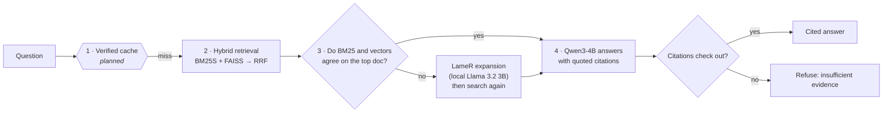

# Adaptive Enterprise RAG

**A support assistant that only searches harder when it needs to.** It runs a cheap search for most questions. When its two retrievers disagree, it runs a second, more expensive search. It then answers with verified citations, or refuses.


> Team 13 project for **CSCI 544 Applied Natural Language Processing** at USC (Fall 2026). It is evaluated on **[EnterpriseRAG-Bench](https://github.com/onyx-dot-app/EnterpriseRAG-Bench)** by Onyx, a simulated company with internal Slack, Gmail, Jira, Confluence, GitHub and CRM data.

---

## The result

On 62 answerable development questions, measured over 8 repeated passes:

| Retrieval strategy | nDCG@5 | Recall@5 | Mean latency |
| --- | ---: | ---: | ---: |
| Dense vectors only (FAISS exact) | 0.807 | 0.919 | 30 ms |
| Hybrid: BM25 + vectors fused with RRF | 0.846 | 0.919 | 30 ms |
| Hybrid + LLM query expansion on **every** question | 0.825 | 0.935 | 1,320 ms |
| **Hybrid + expansion only when the retrievers disagree** | **0.855** | **0.935** | **592 ms** |

**Takeaway:** expanding every query made ranking worse and took 44× longer. Expanding only the 46% of queries where BM25 and vector search pick different top documents gave the **best ranking quality at less than half the cost of always expanding**.

<p align="center">
  
</p>

## How it works



| Stage | What it does | Where |
| --- | --- | --- |
| **Chunk** | Paragraph-aware word windows that keep exact character offsets, so every citation traces back to the source | [`chunking.py`](src/adaptive_retrieval/chunking.py) |
| **Embed** | Qwen3-Embedding-0.6B (1024-d). Questions get a retrieval instruction; documents do not | [`embedding.py`](src/adaptive_retrieval/embedding.py) |
| **Retrieve** | FAISS (flat, HNSW and IVF-PQ compared) and BM25S, fused with Reciprocal Rank Fusion (k = 60) | [`experiments/backends.py`](src/adaptive_retrieval/experiments/backends.py) |
| **Gate** | If the two retrievers' top documents differ, generate hypothetical answers (LameR) and search again | [`experiments/combinations.py`](src/adaptive_retrieval/experiments/combinations.py), [`expansion.py`](src/adaptive_retrieval/experiments/expansion.py) |
| **Generate** | Qwen3-4B-Instruct (4-bit, MLX) gets a 4,096-token evidence budget and must reply in JSON | [`generation.py`](src/adaptive_retrieval/generation.py) |
| **Verify** | Rejects any answer whose source IDs, citation markers or verbatim quotes don't match the retrieved text | [`generation.py`](src/adaptive_retrieval/generation.py) |
| **Measure** | Per-stage latency, tokens, time-to-first-token and full JSONL traces for every query | [`pipeline.py`](src/adaptive_retrieval/pipeline.py) |

Everything runs **locally**: no hosted LLM API, no API keys, and no data leaves the machine.

## Other findings

- **Generation dominates latency.** In the end-to-end prototype, about 96% of response time is the LLM writing the answer (up to about 6 s). By Amdahl's law, making retrieval faster has little effect; **avoiding unnecessary generation** is where the remaining savings are. That motivates the verified cache.
- **A cross-encoder reranker hurt.** `ms-marco-MiniLM-L-6-v2` lowered nDCG@5 from 0.807 to 0.781 on this data. An off-the-shelf web-search reranker does not transfer to enterprise jargon.
- **Keyword search is not dead.** BM25S alone ran in **0.21 ms** on average, and fusing it with vectors added 3.9 nDCG points at almost no latency cost.
- **Exact search wins at this scale.** With 3,098 chunks, approximate indexes (HNSW, IVF-PQ) saved no meaningful time. They become necessary at full-benchmark scale.
- **Semantic paraphrases are the hard case.** The MiniLM baseline scored Hit@5 0.914 on basic questions but 0.640 on semantic ones ([baseline brief](results/midterm/retrieval_eval_20261019-023503/MIDTERM_BRIEF.md)).

## Quick start

```bash
git clone https://github.com/Soorya2201/adaptive-enterprise-rag.git
cd adaptive-enterprise-rag
python -m venv .venv && source .venv/bin/activate

# 1. Tests and a model-free demo (any OS, about 1 minute)
pip install -e ".[optimization-tests]"
python -m unittest discover -s src/tests -v   # 25 pipeline tests
python -m unittest discover -s tests -v       # 14 retrieval-experiment tests
python src/runner.py demo "reset password"

# 2. Full RAG with cited answers (Apple Silicon; downloads about 3.5 GB of models)
pip install -r requirements.txt
python src/runner.py download-models
python src/runner.py prepare-subset && python src/runner.py chunk && python src/runner.py embed
python src/runner.py rag --top-k 5
```

- To reproduce the retrieval experiments (requires [Ollama](https://ollama.com) for query expansion), see [`experiments/optimizations/`](experiments/optimizations/README.md).
- For every CLI flag, metric definition and trace format, see [`docs/RUNNING.md`](docs/RUNNING.md).

## Data and honest scope

| | Full EnterpriseRAG-Bench | This repo |
| --- | ---: | ---: |
| Documents | ~500,000 across 9 tools | **290** (90 gold + 200 hard negatives) → 3,098 chunks |
| Questions | 500 in 10 categories | **100** in 5 categories (69 dev / 15 val / 16 test) |

- All reported numbers are **development-split** observations. Paired-bootstrap intervals are in the analysis output, but gains are not yet confirmed on held-out questions.
- **Latency is not dollar cost.** Local inference makes no paid API calls, but compute and energy are not yet measured.
- The subset has **no multi-document** or **conflicting-information** questions, so neither capability is claimed.
- The citation check proves each quote exists in the source. It does **not** prove the quote entails the claim.

## Roadmap

- [x] Chunking, embeddings and exact vector search
- [x] Retrieval evaluation (Hit@k, MRR, nDCG@5, Recall@5, p95 latency, paired bootstrap)
- [x] Hybrid BM25 + dense retrieval with RRF
- [x] Disagreement-gated query expansion
- [x] Local generation with citation validation and refusal
- [ ] **Verified-answer cache**: reuse an answer only when a paraphrase matches and its cited sources are unchanged (interface in [`components.py`](src/adaptive_retrieval/components.py))
- [ ] Held-out validation and test evaluation, including refusal accuracy on unanswerable questions
- [ ] Answer-correctness scoring and an NLI check that each quote entails its claim
- [ ] Scale to the full ~500k-document corpus, where approximate indexes are needed
- [ ] Dollar and energy cost per answer

## Repository map

```
src/adaptive_retrieval/        core library: chunking, embedding, index, generation, pipeline, CLI
src/adaptive_retrieval/experiments/   retrieval backends, LameR expansion, gating, metrics, runner
src/runner.py                  CLI entry point (demo, chunk, embed, evaluate, search, ask, rag)
experiments/optimizations/     experiment configs + figures
scripts/                       analysis (paired bootstrap) and figure generation
data/subset_documents/         checked-in 290-doc / 100-question subset
results/                       saved evaluation runs
docs/                          architecture, plan, team progress, midterm deck (docs/presentation/)
src/tests/, tests/             39 unit tests (models are faked; CI runs on Python 3.11–3.13)
```

## Team

Built by **Team 13**:

- **[Soorya](https://github.com/Soorya2201)**: midterm presentation, results synthesis across branches, repository consolidation
- **Adith** ([@AdithNG](https://github.com/AdithNG)): project scaffold and plan, evaluation breakdowns, reproduced baseline, team integration
- **Shusei** ([@shuseiyokoi](https://github.com/shuseiyokoi)): dataset filtering, the 100-question subset, first evaluation
- **John**: local retrieval pipeline and CLI, end-to-end RAG with citation checks and live metrics
- **Ty**: retrieval optimization study (FAISS indexes, BM25S, RRF, LameR expansion, gating, figures)

The original team repository is [AdithNG/adaptive-enterprise-retrieval](https://github.com/AdithNG/adaptive-enterprise-retrieval). This repo consolidates all branches into one `main`, with commit history and authorship preserved.

<sub>Dataset: EnterpriseRAG-Bench (Sun et al., 2026, arXiv:2605.05253), MIT license.</sub>
