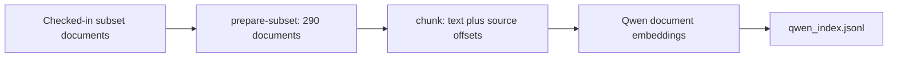
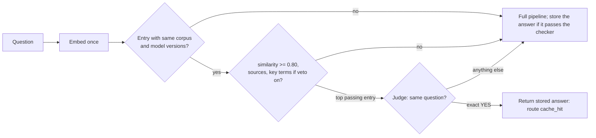

# Local RAG flow and data contracts

> **All saved results quoted in this document are superseded; do not report them.**
> They predate the November 2026 audit fixes: a stricter citation checker, the
> dense baseline moved to FAISS, refusal accounting, cache scoping, and a rebuilt
> corpus and index. They also came from uncommitted code, so their recorded
> commit does not identify what ran. Re-run from a commit before reporting.

## Preparation

`data.py` turns corpus rows into `Document` objects. `chunking.py` creates
paragraph-aware chunks, normally up to 240 words with 40 words of overlap.
Token-based splitting before embedding keeps inputs within the configured
2048-token embedding limit. Each chunk retains its document ID, source path and
exact character offsets. Gold answers and evaluation labels never enter the
index or the generator prompt.

`embedding.py` uses Qwen3-Embedding-0.6B for both documents and questions. Questions
receive a retrieval instruction; document text does not. Embeddings are
normalized. `vector_index.py` stores their 1024 values in JSONL alongside the
text and provenance. Exact cosine ranking is sufficient for this small corpus;
no separate vector database service is required.

The index header records model ID/revision, instruction, corpus SHA-256 and
chunking settings. `SearchSession` checks corpus and query-instruction
compatibility before serving requests. Changing the embedding model requires
rebuilding document vectors, not just changing query encoding.

## Chunk size: 240 words for all remaining experiments

Measured on the 62 answerable dev questions with Qwen3-Embedding-0.6B
(document-level metrics, warm models, cleaned corpus; saved in
`results/chunk_size_comparison/`). The `adaptive` rows used `--expander mlx`
(Qwen3-4B), not the midterm's Llama 3.2 3B.

| Retriever | 240 w: nDCG@5 | Recall@5 | Hit@1 | 120 w: nDCG@5 | Recall@5 | Hit@1 |
| --- | --- | --- | --- | --- | --- | --- |
| Dense (`cosine`) | **0.834** | **0.919** | **0.726** | 0.806 | 0.903 | 0.677 |
| `bm25` | **0.772** | 0.919 | **0.581** | 0.769 | 0.919 | 0.565 |
| `hybrid` | **0.862** | **0.984** | 0.710 | 0.843 | 0.919 | **0.726** |
| `adaptive` | **0.875** | **0.968** | **0.758** | 0.850 | 0.935 | 0.726 |

240-word chunks (40-word overlap, 1,549 chunks) match or beat 120-word chunks
(20-word overlap, 3,191 chunks) on nDCG@5 for every retriever, and hybrid
Recall@5 rises from 57/62 to 61/62. The gate also fires less often (42.0% vs
46.4% of dev questions), so adaptive retrieval is cheaper. For generation,
larger chunks keep more surrounding context with each cited passage; five
passages still fit easily in the 4,096-token prompt. These are 62-question
development results without confidence intervals, so differences of ~0.01 are
not established.

With the midterm's expander (Llama 3.2 3B in Ollama) at 240 words, dev results
are: `hybrid` 0.862 nDCG@5 at 31 ms mean; `adaptive` 0.859 at 1.0 s (gate
fired on 42.0%); `hybrid_lamer` 0.855 at 2.1 s (saved in `results/h2_llama/`).
Gating costs half as much as always-on expansion for slightly better quality,
but neither beats plain hybrid here, unlike the midterm's 120-word result.
Expansion is seeded and usually repeats exactly, but not always; use
`evaluate --repeats 8` (the midterm protocol) and confidence intervals before
claiming H2. These runs timed dense search with a Python loop (79 ms per search
instead of under 1 ms), so their dense latency is not comparable with hybrid.

### Escaped documents in the benchmark

31 of the 290 subset documents store their body as an escaped string (line
breaks as the two characters `\n`, quotes as `\"`). `clean_document_text` in
`data.py` decodes such a document when it has more literal `\n` sequences than
real line breaks. One more (`dsid_275b27e5`) is only partly escaped; its prose
breaks are decoded when at least three follow sentence punctuation and start a
new line or list item. The other 8 documents that contain `\n` show it inside
code or protocol examples and keep it. `prepare-subset`, `build-subset` and
`check-subset` apply it, so the checked-in files stay as distributed. Before
this fix, BM25 read `\nTue` as the word `ntue` and the chunker found no
paragraphs in those documents. Results measured before the fix are in
`results/pre_corpus_fix/`; the fix raised hybrid nDCG@5 from 0.853 to 0.862 at
240 words.

## Runtime: one or two retrieval rounds per question

1. `rag_cli.open_search_session` builds the retriever selected by `--retriever`
   and, for `adaptive`/`hybrid_lamer`, an Ollama or MLX expander.
2. `pipeline.py` warms the embedder, generator and expander once, keeping
   startup outside query timing.
3. `hybrid_search.py` embeds the query and asks its worker process for the dense
   and BM25S rankings separately, so the gate can compare their top documents.
4. When the gate fires, `expansion.py` runs the concise LameR prompt from the
   optimization experiments, and the worker runs a second BM25S search with the
   expanded query. Otherwise the two rankings are fused directly.
5. `generation.py` assigns `[S1]`-style labels and adds whole passages until the
   token budget is reached. The MLX generator returns JSON with an answer and
   quotes, or reports insufficient evidence.
6. `check_answer` rejects incomplete output, invalid JSON, unknown source IDs,
   inline markers without a verified quote, and quotes absent from the cited
   text. A quote is one span of whole tokens: formatting may differ, but words,
   numbers, case and qualifiers cropped from its edges may not (see `quote_match`).
7. The result records the route, retrieval rounds, gate decision, expansion text
   and tokens, and per-stage timings. `rag-eval` repeats this for every question
   in a split; `evaluate` measures retrieval alone.

## Verified-answer cache

### Assumptions

1. **Frozen ground truth.** Documents, chunks and embeddings do not change during
   an experiment. Handling live updates is out of scope.
2. **Any change means a rebuild.** Entries record the corpus and index SHA-256
   and the embedding, generator, prompt and checker versions. If any differs at
   startup, the whole cache is thrown out (the file is renamed to
   `*.stale-<id>`) and rebuilt. There is no partial invalidation.
3. **The experiment uses a warm cache.** Seed questions are run through the
   generator first, and answers that pass the checker are stored. Gold answers
   are never inserted. Warm-cache savings are reported next to the warm-up cost.
4. **In a deployment (future work), the company using the system builds the
   cache** from its own questions and valid answers from the generator. How it
   establishes validity beyond the quote checker, when it rebuilds, and access
   control (the plan's "authorized context") are deployment decisions.

"Passed the checker" means that the quotes exist, not that the answer is
correct, so results also report answers by an AI-assigned correctness label.

### Who assigned the correctness labels

**No human has verified them.** Every "right", "mostly right", "partly correct"
and "wrong" label in the cache experiments and the `VERDICT` lines of the seed
files was assigned by Claude (the AI coding assistant), in one pass, by reading
the answer next to the benchmark's `gold_answer`. Some source passages were
spot-checked. There was no written rubric, blinding or second grader, and the
same assistant designed the cache. Treat the labels as provisional until a
person grades them.

The seeds are also a favorable sample. They were picked from 38 answered dev/val
questions using those labels: all 24 right or mostly right answers and only 6 of
the 14 others. So 80% of warm-cache answers are labeled right, against 63% of
what the generator and checker actually admit. Wrong-answer reuse measured on
these seeds therefore likely understates the real rate.

`judge.py` sees only the two questions and is called at most once per lookup. A
hit runs no retrieval.

### First experiment: the current checks do not separate near-misses

`results/cache_eval_adaptive_20261122-005503`: 30 seeds (all cached), 15
paraphrases and 15 near-misses, rules unchanged from before the variants were seen.

| Threshold | Paraphrase matched | ...with a correct or mostly correct answer | Near-miss wrongly reused |
| --- | --- | --- | --- |
| 0.90 (default) | 10/15 | 8/15 | 2/15 |
| 0.95 | 5/15 | 3/15 | 1/15 |
| 0.98 (chosen on dev, 0.01 grid) | 1/15 | 0/15 | 0/15 |
| 0.9738 (post-hoc, fine grid on dev) | 3/15 | 2/15 | 0/15 |

- **No robust safe threshold.** Near-miss qst_0087 (default vs maximum window) has
  similarity 0.9713 and passes every check. The zero-wrong-reuse window with the
  most dev hits is 0.9713-0.9738, too narrow to rely on.
- **The extra checks add nothing at that operating point:** similarity alone gives
  identical decisions. At 0.90 the key-term check cuts wrong reuse from 4 to 2; the
  evidence check prevents none and blocks one valid paraphrase (qst_0399).
- **Six of 15 near-misses pass all non-similarity checks** (qst_0030, 0087, 0131,
  0181, 0301, 0410). They ask a different thing about the same document.
- **Wrong answers propagate:** 2 of the 10 paraphrase matches at 0.90 return a
  wrong stored answer.
- **Cost:** a hit takes about 34 ms and no LLM tokens, vs 6.6 s and 4,207 tokens.
  A miss adds about 1.4 ms beyond the embedding retrieval already needs.

Limits: the sample is small (0/15 still allows about 18% wrong reuse at 95%
one-sided confidence; 0/4 on val allows 53%). The qst_0104 near-miss is the
template's worked example and was used in the smoke test, so it is not
independent; dropping it does not change the chosen threshold. These variants
have now been inspected, so any revised rule needs fresh variants. H3 is not
supported by this configuration.

### Second experiment: same-question judge

`results/cache_eval_adaptive_20261122-025156`, same 30 variants, threshold 0.80.
Prompt and threshold were frozen before the run, but designed after seeing these
variants, so these are **development results**, including the val rows.

| Configuration | Paraphrase matched | Right or mostly right | Near-miss reused |
| --- | --- | --- | --- |
| Similarity only | 15/15 | 12/15 | 9/15 |
| Checks, no judge | 14/15 | 11/15 | 4/15 |
| **Checks + Qwen judge (default)** | **14/15** | **11/15** | **0/15** |
| Qwen judge, no key-term veto | 15/15 | 12/15 | 0/15 |
| Checks + Llama judge | 0/15 | 0/15 | 0/15 |

- **Llama is unusable as this judge:** it says NO to every paraphrase and to 10
  of 30 word-for-word repeats. Qwen says YES to 30/30 repeats and NO to 30/30
  other-seed pairs.
- **Robustness (`judge_stress.jsonl`):** Qwen's 30 decisions are unchanged with
  the question order swapped or a neutral prompt. On 38 new pairs in unrelated
  domains it made 0/26 false YES in either order and 12/12 and 11/12 true YES.
  Claude wrote both those pairs and the prompt, so they are not independent.
- **The key-term veto prevented nothing the judge missed** and cost 1/15
  paraphrases here and 3/12 in the probe.
- **Live pipeline (`live_audit.jsonl`):** decisions match the replay 30/30. A
  hit took 431 ms and 287 tokens vs 6,480 ms and 3,861 tokens for the same
  questions without a cache. A judged rejection costs about 380 ms and 280
  tokens. This half-paraphrase workload saved 49% of time and 42% of tokens
  with warm-up ignored; real savings depend on the repeat rate and warm-up.
- **The cache can be worse than no cache.** On the 14 hit questions (graded by Claude, not blind) both give 11 right or mostly right answers, but the cache
  gives 3 wrong vs 2 wrong and 1 refusal. qst_0126: correct becomes wrong.
  qst_0184: refusal becomes wrong. qst_0409: wrong becomes correct.
- **Out of scope under the frozen-corpus assumption:** in a probe with an added
  superseding document the cache missed as intended, but the generator still
  answered with the superseded value. This matters for future live-update work,
  not for H3.

#### Effect of what is allowed into the warm cache

| Warm cache contains | Seeds | Paraphrase matched | Wrong stored answer served | Near-miss reused |
| --- | --- | --- | --- | --- |
| Generated answers that pass the checker, selected seeds (measured) | 30 | 14/15 | 3 | 0/15 |
| Only answers Claude labeled right or mostly right (simulated offline) | 24 | 11/12 | 0 | 0/12 |

The second row removes six entries from the saved decisions; it was not run. Its
0 wrong answers follows from the filter by definition and says nothing about
whether a real correctness gate would find those answers. On its 11 hits Claude
labeled 11 cached and 10 uncached answers right or mostly right; one borderline
label (qst_0409) makes that difference, so it does not establish preserved quality.

Time for the 30 test questions (169 s without a cache) depends on who pays for
the 196 s warm-up:

| Accounting | 30-seed cache | 24-seed cache (simulated) |
| --- | --- | --- |
| Warm-up ignored | 49% less time | 39% less time |
| Seeds are real user questions that needed answering anyway | 22% less | 18% less |
| Seeds are asked only to fill the cache (this experiment's setup) | **67% more** | **77% more** |

In the last case the cache pays for itself after about 72 (30-seed) or 89
(24-seed) test questions with this mix of half paraphrases and half near-misses.

H3 status on development data: a warm hit is much cheaper, net savings depend on
the repeat rate and warm-up, and preserved quality is not established. It needs
human grading and one frozen run on unselected seeds with fresh variants.

## Evidence checks are limited

The generator judges whether the passages answer the question. Code verifies
output structure and the existence of cited quotes. Neither cosine similarity
nor a quote being present proves that a claim is supported. There is no trained
entailment verifier or calibrated refusal threshold yet; the cache reuses
answers that passed these checks, so it inherits their limits.
Refusal reasons distinguish reported insufficient evidence from format/citation
failures; the latter should not be presented as evidence of semantic judgment.

**History of the quote check.** A formatting-tolerant check (v1) raised dev
answers from 22 to 29 of 69 on identical generations
(`results/pre_corpus_fix/rag_eval_adaptive_dev_20261119-005735`). It was unsafe:
it and the original substring check accepted "5 business days" from "15 business
days", and v1 also spliced over words such as "not" and deleted characters inside
numbers (`2*3` as `23`). The current check (v2) had no false accepts in corpus
fuzzing (cut tokens, changed digits, splices, cropped negations) and still
accepts 99.7% of verbatim source lines. Replayed on the saved generations, it
changes one answer (qst_0382, a spliced quote) to a refusal. It remains a
provenance check, not a correctness check.

**False refusals, corrected.** In `results/rag_eval_adaptive_dev_20261119-092234`
33 of 62 answerable questions were refused: 16 model-reported insufficient
evidence and 17 rejected by checks (11 quote not in source, 3 invalid quote, 2
missing citations, 1 invalid JSON). An earlier version of this section reported
23 insufficient-evidence refusals because it included the 7 correct refusals of
unanswerable questions. `rag-eval` now reports the two separately.

## Measurement boundaries

- Startup includes index load, model load and warmup; it is reported separately.
- Query total covers retrieval, prompt building, generation and validation.
- First-token time starts at generation; decode speed excludes prompt prefill.
- Token counts are the generator's actual input/output counts, including JSON.
- Each request uses one retrieval round, or two when the gate expands, and at
  most one answer-generation call plus two expansion calls.
- Total LLM tokens include expansion input/output tokens as well as generation.
- `cost_usd` is null: timings and tokens describe local workload, not electricity
  consumption, financial savings or answer quality.

The default models are downloaded explicitly by `download-models`, pinned to
revisions in `model_store.py`, and loaded locally thereafter. The MLX generator
requires Apple Silicon. Persistent sessions reuse model weights; answers are reused
across questions only with `--cache`. Retrieved results and prompts are never cached.
