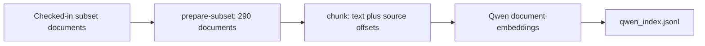
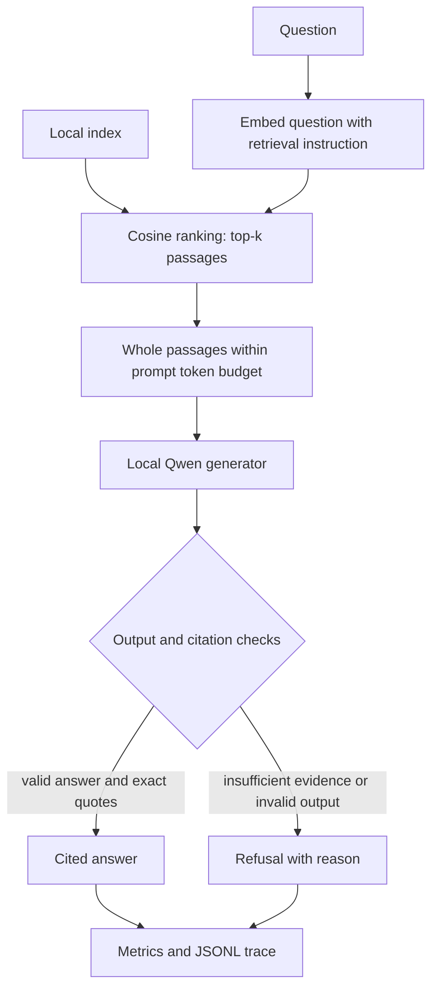

# Local RAG flow and data contracts

## Preparation: run before presenting

`data.py` turns corpus rows into `Document` objects. `chunking.py` creates
paragraph-aware chunks, normally up to 240 words with 40 words of overlap.
Token-based splitting before embedding keeps inputs within the configured
2048-token embedding limit. Each chunk retains its document ID, source path and
exact character offsets. Gold answers and evaluation labels never enter the
index or the generator prompt.

`embedding.py` uses Qwen3-Embedding-0.6B for both documents and questions. Questions
receive a retrieval instruction; document text does not. Embeddings are
normalized. `vector_index.py` stores their 1024 values in JSONL alongside the
text and provenance. Exact cosine ranking is sufficient for this small corpus;
no separate vector database service is required.

The index header records model ID/revision, instruction, corpus SHA-256 and
chunking settings. `SearchSession` checks corpus and query-instruction
compatibility before serving requests. Changing the embedding model requires
rebuilding document vectors, not just changing query encoding.

## Runtime: one retrieval round per question

1. `runner.py rag` creates one `SearchSession` and one `QwenGenerator`.
2. `pipeline.py` warms both models once, keeping startup outside query timing.
3. `interactive.py` embeds the query and ranks the stored vectors, recording
   embedding and search time separately.
4. `generation.py` assigns `[S1]`-style labels and adds whole passages until the
   token budget is reached. It skips oversized passages and duplicate chunks.
5. The local MLX generator produces JSON with an answer and cited quotes, or
   reports insufficient evidence. Its prompt prohibits outside knowledge.
6. `check_answer` rejects incomplete output, invalid JSON, unknown source IDs,
   mismatched citation markers and quotes absent from the cited text.
7. `rag_cli.py` displays the result, source addresses and live metrics, and saves
   the structured trace. `/sources` reveals the actual retrieved context.

`pipeline.py` is the coordinator: it calls each component in order and collects
measurements. It does not train a model. `search` and `interactive` remain
retrieval-only tools; `ask` and `rag` include answer generation.

## Evidence checks are limited

The generator judges whether the passages answer the question. Code verifies
output structure and the existence of cited quotes. Neither cosine similarity
nor a quote being present proves that a claim is supported. There is no trained
entailment verifier, calibrated refusal threshold, or verified-answer cache yet.
Refusal reasons distinguish reported insufficient evidence from format/citation
failures; the latter should not be presented as evidence of semantic judgment.

## Measurement boundaries

- Startup includes index load, model load and warmup; it is reported separately.
- Query total covers retrieval, prompt building, generation and validation.
- First-token time starts at generation; decode speed excludes prompt prefill.
- Token counts are the generator's actual input/output counts, including JSON.
- Each request uses one retrieval round and at most one generator call.
- `cost_usd` is null: timings and tokens describe local workload, not electricity
  consumption, financial savings or answer quality.

The default models are downloaded explicitly by `download-models`, pinned to
revisions in `model_store.py`, and loaded locally thereafter. The MLX generator
requires Apple Silicon. Persistent sessions reuse model weights but do not cache
answers, retrieved results or prompts across questions.
