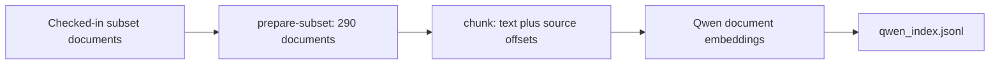
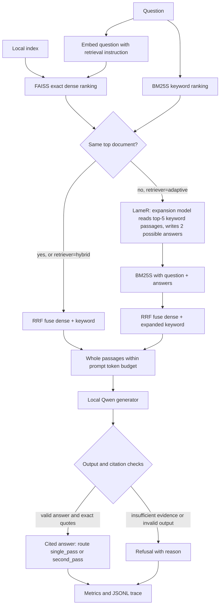

# Local RAG flow and data contracts

## Preparation

`data.py` turns corpus rows into `Document` objects. `chunking.py` creates
paragraph-aware chunks, normally up to 240 words with 40 words of overlap.
Token-based splitting before embedding keeps inputs within the configured
2048-token embedding limit. Each chunk retains its document ID, source path and
exact character offsets. Gold answers and evaluation labels never enter the
index or the generator prompt.

`embedding.py` uses Qwen3-Embedding-0.6B for both documents and questions. Questions
receive a retrieval instruction; document text does not. Embeddings are
normalized. `vector_index.py` stores their 1024 values in JSONL alongside the
text and provenance. Exact cosine ranking is sufficient for this small corpus;
no separate vector database service is required.

The index header records model ID/revision, instruction, corpus SHA-256 and
chunking settings. `SearchSession` checks corpus and query-instruction
compatibility before serving requests. Changing the embedding model requires
rebuilding document vectors, not just changing query encoding.

## Chunk size: 240 words for all remaining experiments

Measured on the 62 answerable dev questions with Qwen3-Embedding-0.6B
(document-level metrics, warm models, cleaned corpus; saved in
`results/chunk_size_comparison/`). The `adaptive` rows used `--expander mlx`
(Qwen3-4B), not the midterm's Llama 3.2 3B.

| Retriever | 240 w: nDCG@5 | Recall@5 | Hit@1 | 120 w: nDCG@5 | Recall@5 | Hit@1 |
| --- | --- | --- | --- | --- | --- | --- |
| Dense (`cosine`) | **0.834** | **0.919** | **0.726** | 0.806 | 0.903 | 0.677 |
| `bm25` | **0.772** | 0.919 | **0.581** | 0.769 | 0.919 | 0.565 |
| `hybrid` | **0.862** | **0.984** | 0.710 | 0.843 | 0.919 | **0.726** |
| `adaptive` | **0.875** | **0.968** | **0.758** | 0.850 | 0.935 | 0.726 |

240-word chunks (40-word overlap, 1,549 chunks) match or beat 120-word chunks
(20-word overlap, 3,191 chunks) on nDCG@5 for every retriever, and hybrid
Recall@5 rises from 57/62 to 61/62. The gate also fires less often (42.0% vs
46.4% of dev questions), so adaptive retrieval is cheaper. For generation,
larger chunks keep more surrounding context with each cited passage; five
passages still fit easily in the 4,096-token prompt. These are 62-question
development results without confidence intervals, so differences of ~0.01 are
not established.

With the midterm's expander (Llama 3.2 3B in Ollama) at 240 words, dev results
are: `hybrid` 0.862 nDCG@5 at 31 ms mean; `adaptive` 0.859 at 1.0 s (gate
fired on 42.0%); `hybrid_lamer` 0.855 at 2.1 s (saved in `results/h2_llama/`).
Gating costs half as much as always-on expansion for slightly better quality,
but neither beats plain hybrid here, unlike the midterm's 120-word result.
Expansion is not fully deterministic, so report repeated runs before claiming H2.

### Escaped documents in the benchmark

31 of the 290 subset documents store their body as an escaped string (line
breaks as the two characters `\n`, quotes as `\"`). `clean_document_text` in
`data.py` decodes a document only when it has more literal `\n` sequences than
real line breaks; the 8 other documents that contain `\n` show it inside code
or protocol examples and keep it. `prepare-subset`, `build-subset` and
`check-subset` apply it, so the checked-in files stay as distributed. Before
this fix, BM25 read `\nTue` as the word `ntue` and the chunker found no
paragraphs in those documents. Results measured before the fix are in
`results/pre_corpus_fix/`; the fix raised hybrid nDCG@5 from 0.853 to 0.862 at
240 words.

## Runtime: one or two retrieval rounds per question

1. `rag_cli.open_search_session` builds the retriever selected by `--retriever`
   and, for `adaptive`/`hybrid_lamer`, an Ollama or MLX expander.
2. `pipeline.py` warms the embedder, generator and expander once, keeping
   startup outside query timing.
3. `hybrid_search.py` embeds the query and asks its worker process for the dense
   and BM25S rankings separately, so the gate can compare their top documents.
4. When the gate fires, `expansion.py` runs the concise LameR prompt from the
   optimization experiments, and the worker runs a second BM25S search with the
   expanded query. Otherwise the two rankings are fused directly.
5. `generation.py` assigns `[S1]`-style labels and adds whole passages until the
   token budget is reached. The MLX generator returns JSON with an answer and
   quotes, or reports insufficient evidence.
6. `check_answer` rejects incomplete output, invalid JSON, unknown source IDs,
   inline markers without a verified quote, and quotes absent from the cited
   text. Quote matching ignores formatting only (whitespace, case, bullets,
   Markdown characters, typographic punctuation, escaped line breaks) and
   allows `...` between in-order fragments of at least 12 characters.
7. The result records the route, retrieval rounds, gate decision, expansion text
   and tokens, and per-stage timings. `rag-eval` repeats this for every question
   in a split; `evaluate` measures retrieval alone.

## Evidence checks are limited

The generator judges whether the passages answer the question. Code verifies
output structure and the existence of cited quotes. Neither cosine similarity
nor a quote being present proves that a claim is supported. There is no trained
entailment verifier, calibrated refusal threshold, or verified-answer cache yet.
Refusal reasons distinguish reported insufficient evidence from format/citation
failures; the latter should not be presented as evidence of semantic judgment.

Formatting-tolerant quote matching raised the dev answer rate (adaptive, Llama
expander) from 0.319 to 0.420 and lowered false refusals from 40 to 33 of 62
answerable questions, with identical generations
(`results/pre_corpus_fix/rag_eval_adaptive_dev_20261119-005735`). All 7
unanswerable questions were still refused. Of the 7 newly accepted answers, 4
match the gold answer, 1 is partly wrong and 2 answer from the wrong document.
Tolerance therefore admits some wrong answers; answer-correctness scoring is
still required before answers are cached or reported as correct.

On the cleaned corpus (`results/rag_eval_adaptive_dev_20261119-092234`) the
answer rate stays 0.420 with 33 false refusals: 23 model-reported insufficient
evidence, 11 quotes not in the cited source, 3 invalid quotes, 2 missing
citations and 1 invalid JSON. The gold document reached the prompt for 93.5%
of answerable questions, and 72.4% of answers cite it.

## Measurement boundaries

- Startup includes index load, model load and warmup; it is reported separately.
- Query total covers retrieval, prompt building, generation and validation.
- First-token time starts at generation; decode speed excludes prompt prefill.
- Token counts are the generator's actual input/output counts, including JSON.
- Each request uses one retrieval round, or two when the gate expands, and at
  most one answer-generation call plus two expansion calls.
- Total LLM tokens include expansion input/output tokens as well as generation.
- `cost_usd` is null: timings and tokens describe local workload, not electricity
  consumption, financial savings or answer quality.

The default models are downloaded explicitly by `download-models`, pinned to
revisions in `model_store.py`, and loaded locally thereafter. The MLX generator
requires Apple Silicon. Persistent sessions reuse model weights but do not cache
answers, retrieved results or prompts across questions.
