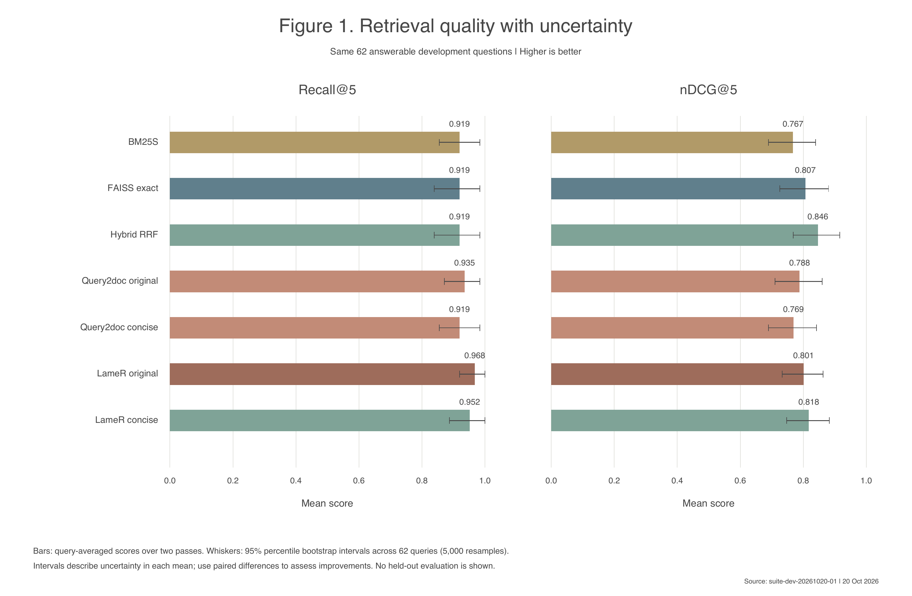
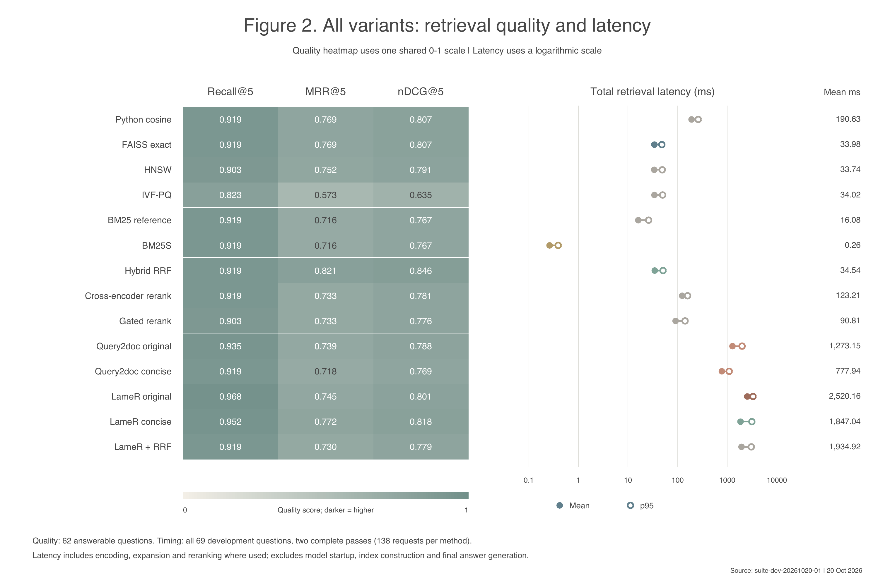
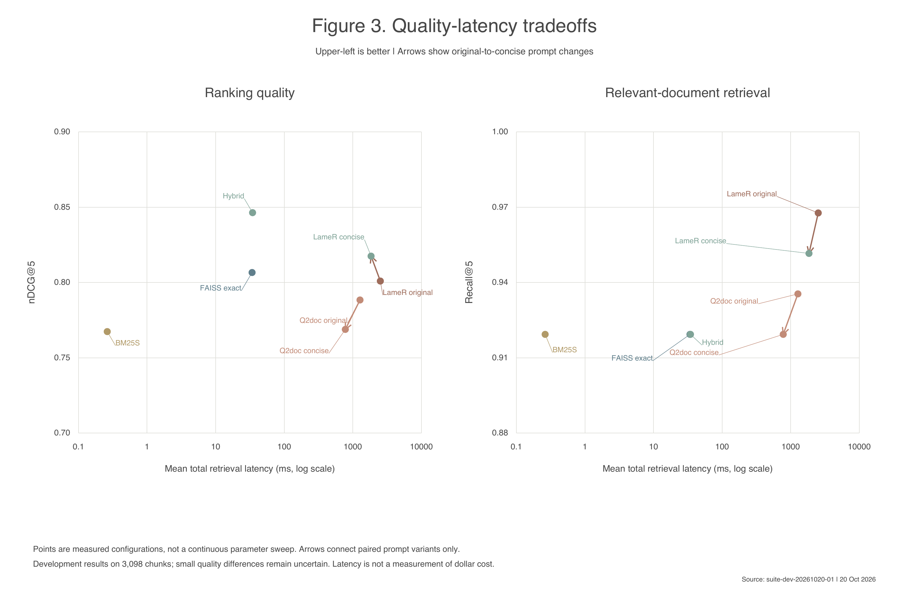
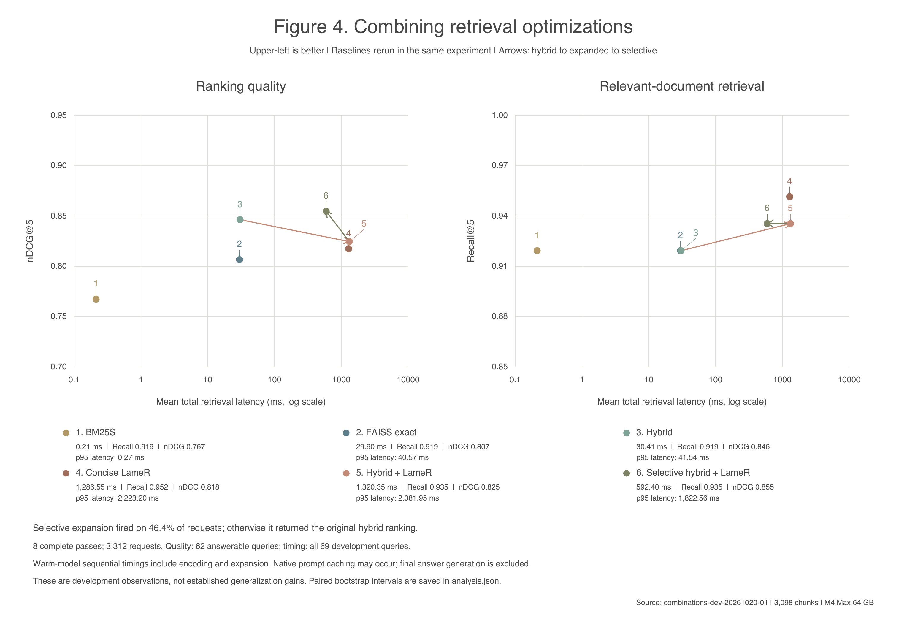

# Retrieval optimization experiments

This folder contains experiments for testing retrieval optimizations on the enterprise-support data.

## Takeaways

This pipeline was built to test various optimizations on our enterprise-support development data. I mainly looked at recall and nDCG against latency. From that, hybrid BM25S + FAISS exact gave the best balance. It improved nDCG@5 from 80.7% to 84.6% and reduced mean retrieval latency from 190.6ms to 34.5ms (5.5x faster) when compared to the Python cosine baseline used in the experiment. Recall@5 stayed at 91.9%.

Selective hybrid + LameR had the highest nDCG@5 (85.5%), 6.0% higher than FAISS exact, with Recall@5 increasing from 91.9% to 93.5%. However, it takes significantly longer (mean latency rose from 29.9ms to 592.4ms in the combination run), so hybrid without expansion is likely the stronger speed/quality choice unless we really want a little more retrieval quality and don't mind the vastly slower retrieval time.

These are observed development results; the quality gains still need validation on unseen questions.

Setup below if you want to replicate the tests and/or use the optimizations for our subsequent tests.

## Setup

Run from the repository root (Python 3.11+, Apple MPS by default):

```sh
python3 -m venv .venv
source .venv/bin/activate
python -m pip install -e '.[optimizations,figures]'
git fetch origin
python -m adaptive_retrieval.experiments.prepare --download
```

Skip preparation if `data/processed/optimization-suite` already exists. Install Ollama, start `ollama serve` in another terminal, then run:

```sh
ollama pull llama3.2:3b
python -m adaptive_retrieval.experiments.run --config experiments/optimizations/suite.json --output outputs/isolated
python scripts/analyze_optimizations.py outputs/isolated
```

Expansion connects to local Ollama at `http://127.0.0.1:11434`. This address means your own computer, so teammates do not need to change it; each person must run Ollama locally. A different server or port would require changing the URL in `src/adaptive_retrieval/experiments/expansion.py`.

Use a fresh output directory per run. Add `--limit 1` for a smoke test; use `combinations.json` to test combined methods.

## Files

- `src/adaptive_retrieval/experiments/`: data preparation, search backends, expansion, combinations, model worker, experiment runner, and metrics.
- `experiments/optimizations/`: individual and combined experiment settings.
- `scripts/analyze_optimizations.py`: balanced comparisons and uncertainty estimates.
- `scripts/plot_paper_figures.py` / `plot_combination_tradeoffs.py`: figures 1–3 / 4; pass `--run` with the analyzed output directory.
- `tests/test_{experiment_suite,expansion,combinations,metrics}.py`: optimization tests. Run `python -m unittest discover -s tests -v`.

## Results

Rankings, timings, generations, and metrics are recorded locally under `outputs/`.
Charts are sent to `output/pdf/`. The four figures generated so far are below:









